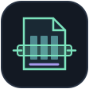
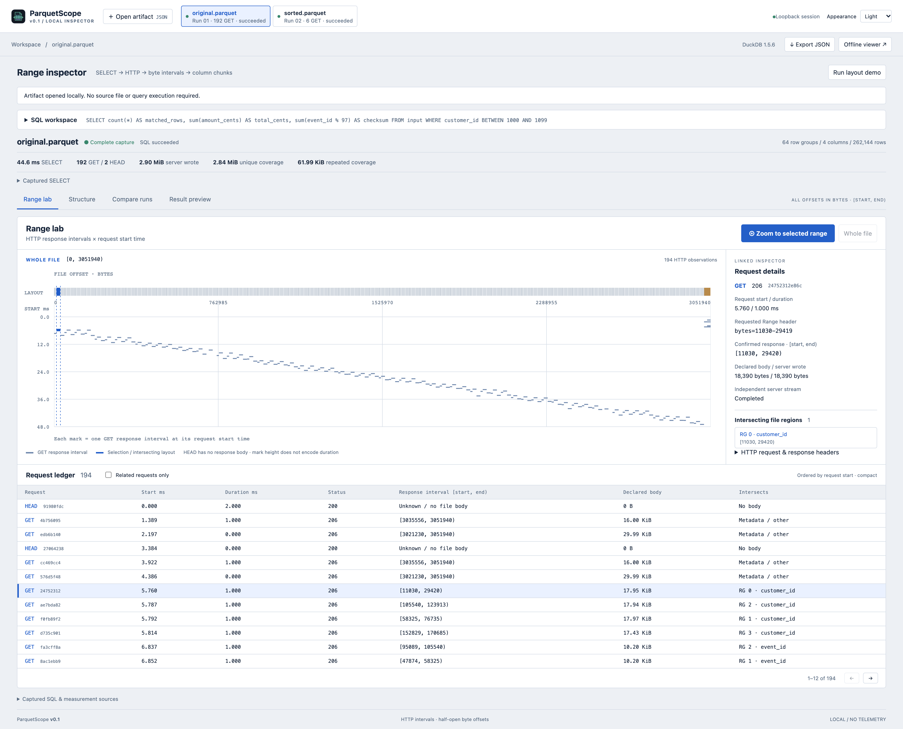

<p align="center"></p>

# ParquetScope

Visualize DuckDB’s Parquet range reads, map them to file structure, and compare query runs.

[](pyproject.toml)
[](https://duckdb.org/docs/current/operations_manual/logging/overview)
[](pyproject.toml)
[](LICENSE)
[](https://github.com/0then0/parquetscope/actions/workflows/ci.yml)

A local diagnostic tool connecting **one SELECT → real HTTP requests → byte intervals → Parquet column chunks**. Run two queries or compare two file layouts, inspect linked selections, and share a portable capture. No accounts, telemetry, cloud credentials, or external viewer resources.



Range lab is the main workspace. File byte offsets run horizontally; request start time runs vertically. Selecting a GET connects its exact response interval, timing, independent server writes and intersecting column chunks on one screen. **Zoom to selected range** expands the selected request or chunk across the byte axis; **Whole file** restores context. The compact request ledger remains exact at every zoom level. Layout is a proportional track on the same byte axis, with the full region list under **Structure**. **Compare runs** remains available for paired measurements.

[Zoomed selection, 3840 px wide](docs/range-lab-zoom.png) · [Dark theme, 3840 px wide](docs/range-lab-dark.png). All screenshots use real demo captures and a 2× pixel density.

## Quick start

From this checkout, with [uv](https://docs.astral.sh/uv/) installed:

```sh
uv sync --frozen
uv run parquetscope setup
uv run parquetscope serve --demo
```

Open **http://127.0.0.1:8400** and click **Run layout demo**. The app creates two real Parquet layouts, verifies their data equality, and captures the same SELECT in two fresh worker processes. Choose a run to open **Range lab**. Select a request to inspect its intersecting chunks, or choose a chunk under **Structure** and enable **Related requests only**. Use **Zoom to selected range** to inspect narrow intervals in a dense trace. **Compare runs** shows SQL, versions, settings, identities and measured totals.

The production frontend is included in the Python package and this checkout. End users need **no Node.js**. `setup` downloads the signed httpfs extension for **DuckDB 1.5.6** into `~/.cache/parquetscope/extensions`. It is explicit and outside capture. After setup, the local demo, query execution and viewer need no external internet. Set `PARQUETSCOPE_HOME` to relocate that cache. A missing extension gives a run error; it is never silently installed during measurement.

Open your own explicitly selected file:

```sh
uv run parquetscope serve /path/to/events.parquet
```

The SQL input is always the `input` view:

```sql
SELECT customer_id, sum(amount_cents)
FROM input
WHERE customer_id BETWEEN 1000 AND 1099
GROUP BY customer_id
```

The original file is read only. CLI capture refuses an output path that refers to the input file, including symbolic and hard links. The browser does not accept arbitrary server paths. Multiple files can be made available at startup, but each run reads exactly one selected file. Only one capture runs at a time. DuckDB’s statement extractor accepts one SELECT; external access is disabled except for that run’s generated, single-file loopback URL, and configuration is locked. This is a local tool for trusted SQL and Parquet files, not an OS security sandbox for hostile input.

## Capture, demo and offline artifacts

```sh
# Generate both layouts, verify all persisted data and query results, save both traces.
uv run parquetscope demo --output demo-output

# Execute once, fully consume the result, save a versioned artifact.
uv run parquetscope capture demo-output/sorted.parquet \
  --sql 'SELECT sum(amount_cents) FROM input WHERE customer_id BETWEEN 1000 AND 1099' \
  --output run.parquetscope.json --deadline 30

# Open one or several artifacts without the source files or query execution.
uv run parquetscope serve --artifact demo-output/original.parquetscope.json \
  --artifact demo-output/sorted.parquetscope.json

# Produce one self-contained HTML file, then open it directly in a browser offline.
uv run parquetscope viewer run.parquetscope.json --output run.viewer.html
```

**Export JSON** and **Offline viewer** provide the same workflows from the UI. The standalone HTML can import more JSON captures and compare them with its embedded run while offline. The Python server is not needed for that HTML. Offline opening is tested with network access disabled and zero HTTP(S) requests.

Artifacts omit result preview rows, min/max statistics, original table rows and absolute source paths. They retain SQL, column names, file identity, byte layout, HTTP headers and a digest of ordered result values. SQL and metadata can themselves reveal data: inspect a capture before sharing it. Byte offsets and byte counts are **decimal strings**; the viewer uses `BigInt`. Values beyond JavaScript’s safe integer range are never silently rounded. See the [artifact contract](docs/artifacts.md).

## What the measurements mean

- **Requested ranges:** DuckDB’s structured request headers. Half-open intervals are resolved from inclusive HTTP ranges using the known file size. Raw Range headers remain available.
- **Confirmed response ranges:** DuckDB’s response headers (`Content-Range` for 206, full file for a confirmed 200). These confirm the described response interval, not client receipt of every byte.
- **Declared response body:** GET `Content-Length`. HEAD advertises file size but contributes **zero body bytes**.
- **Server wrote:** bytes successfully written by the independent server to the response stream. This is not a guarantee of bytes received, decoded or used by DuckDB.
- **Unique coverage:** length of the union of confirmed GET response intervals. **Repeated coverage:** sum of their lengths minus that union. Overlap is not automatically an error or waste.
- **SELECT duration:** wall time from executing the user SELECT until its results are fully consumed. **Elapsed:** includes worker startup, input view binding, capture and cleanup, after app metadata preparation.

The trace includes the HTTP requests needed to bind `input` plus the one SELECT. Application metadata extraction and SHA-256 hashing happen **before** the Range endpoint is started. They are preparation costs, not query reads. No second EXPLAIN or query execution is hidden in the run.

The server independently records method, raw Range, response range, status, declared and written body bytes, start/duration and stream completion. Unique response IDs connect logs and server observations even for concurrent identical requests. Reconciliation checks IDs, method, range, status and declared length, without assuming request order.

**SQL status and capture completeness are separate.** A failed SELECT can still have a complete HTTP trace. A killed worker may lose engine logs: surviving server observations are retained and totals are explicitly marked **observed subset**. Missing measurements use null with reasons. File identity changes during capture invalidate the run. See [measurement boundaries](docs/measurements.md).

## Reproducible demo

Seed **20261019**, 262,144 rows, 64 row groups of 4,096 rows, Zstandard compression and dictionary encoding. Four columns: `event_id`, `customer_id`, `amount_cents`, `region`. Both layouts contain exactly the same values; the second is sorted by `customer_id`.

```sql
SELECT count(*) AS matched_rows, sum(amount_cents) AS total_cents,
       sum(event_id % 97) AS checksum
FROM input
WHERE customer_id BETWEEN 1000 AND 1099
```

The aggregate reads real data columns; it is not a metadata-only `COUNT(*)` or a partial `LIMIT` workload. Persisted layouts are fully compared after restoring event order, and query values are checked against an independent Python calculation.

Measured on macOS arm64, Python 3.13.16, DuckDB 1.5.6, PyArrow 26.0.0:

- Original layout: **192 GET + 2 HEAD**, **3,048,953** server-written bytes; unique coverage **2,985,475** bytes.
- Sorted layout: **6 GET + 2 HEAD**, **146,149** server-written bytes; unique coverage **75,557** bytes.
- Both results: **265**, **13,418,858**, **12,042**. About **95.2% fewer server-written body bytes** in this measured pair. Repeated coverage was **63,478** vs **70,592** bytes, so it is not assumed to decrease with total bytes.

These are observations, not fixed expected request sequences. Parallel scheduling, timing and platform can change the trace. `demo-output/report.json` records the actual metrics and conditions of every CLI demo. Each capture has a fresh worker and disabled external file cache. **Cold client does not mean cold OS cache, disk or S3.** A portable evidence report is in [docs/demo-report.json](docs/demo-report.json).

## Runtime and UI limits

Defaults: 30-second deadline, 512 MiB **DuckDB engine** memory limit, four threads, 30 preview rows / 64 KiB. Results are consumed in batches of 512 rows; preview limits do not stop consumption. Disk spilling is disabled. DuckDB’s memory limit is not an OS cap on all Python/native allocations, and one very large value can still be expensive. Cancellation or deadline terminates, then forcibly kills if needed, and reaps the owned worker; the server stops, closes active sockets, joins handlers and closes its file descriptor.

Limits: 32 MiB per artifact, 100,000 HTTP observations, 100,000 structure regions and 20 runs per session. The parent stops captures that exceed the server observation limit. Range lab draws all GET response intervals and all layout regions on a canvas; narrow marks can overlap at whole-file scale. It does not sample requests or make regions equal-sized. Zoom changes the byte domain, while the request-time axis stays fixed. Mark height does not encode duration; start and duration remain explicit in the ledger and inspector. HEAD contributes no response-body mark. The UI renders 12 compact request rows or 50 structure rows per page, and at most 30 linked regions in request details. Exact ranges remain available in the paginated structure/request views and JSON. Zoom subtracts byte offsets using BigInt before converting the relative position to pixels. Theme follows the system or can be set to light/dark. Controls support keyboard navigation; Ctrl/Cmd+Enter runs SQL.

## Development and checks

Node.js **24** and pnpm **12.14.0** are needed only to change the frontend. Python dependencies use `uv.lock`; frontend dependencies use `frontend/pnpm-lock.yaml` with exact package versions.

```sh
uv sync --frozen
uv run parquetscope setup
pnpm --dir frontend install --frozen-lockfile
pnpm --dir frontend exec playwright install chromium
uv run ruff check src tests scripts
uv run ruff format --check src tests scripts
uv run pytest -q
uv run python scripts/generate_schema.py --check
pnpm --dir frontend check
pnpm --dir frontend test
pnpm --dir frontend build
pnpm --dir frontend test:browser
uv build
uv run python scripts/check_dist.py
```

Production assets are checked in under `src/parquetscope/static/` so source and wheel installs work without a frontend toolchain. After a frontend change, rebuild them. CI verifies the generated schema, rebuilds the frontend, runs real backend and browser scenarios, builds a wheel and tests an isolated wheel install. Development UI: run the Python app on port 8400 and `pnpm --dir frontend dev` for Vite’s loopback proxy.

## Packaging and platforms

**Pinned execution engine: DuckDB 1.5.6 only.** Python package requires Python 3.10+. Current local validation: macOS arm64 and Linux arm64 containers on Python 3.13; CI targets Linux x86_64 with Python 3.10 and 3.13. Windows is **not declared supported**. React 19.3.1, Vite 8.3.4 and TypeScript 7.0.2 are build-time choices, not end-user requirements. See [validation evidence](docs/validation.md) for exactly what ran.

Build distributables locally with `uv build`. The wheel embeds both the production SPA and standalone offline template; the sdist also includes frontend sources and lockfiles. Install with `uv pip install dist/parquetscope-0.1.0-py3-none-any.whl` in a fresh environment, run `parquetscope setup`, then `parquetscope serve --demo`. [Release instructions](docs/releasing.md) include the smoke checks. Nothing is automatically published.

## Architecture

`metadata.py` prepares a read-only file identity and PyArrow layout. `range_server.py` serves only that selected file over a generated loopback route and records independent observations. `capture.py` owns its lifecycle and a fresh `worker.py` subprocess. The worker loads preinstalled httpfs, restricts access, binds `input`, executes one SELECT, consumes results and extracts native structured logs. `analysis.py` derives range metrics. Pydantic models validate the portable artifact. FastAPI manages bounded local jobs and serves the bundled React UI. No database or cloud service is involved.

Column chunk starts use the minimum valid dictionary/data page offset and compressed length, **not** an unchecked `file_offset` (which PyArrow-written files can report as zero). The footer includes serialized metadata, its four-byte length and trailing magic. Unknown gaps stay **unclassified**. Row groups are identified through chunk metadata; no claim is made that their chunks form one universally contiguous region. No custom Parquet page decoder or optimizer reconstruction is used.

## Context and scope

DuckDB’s [structured logging](https://duckdb.org/docs/current/operations_manual/logging/overview) supplies engine observations; Apache Parquet’s [file format](https://parquet.apache.org/docs/file-format/) and [metadata specification](https://parquet.apache.org/docs/file-format/metadata/) define the mapped structure. DuckDB [issue #21474](https://github.com/duckdb/duckdb/issues/21474) is a historical diagnostic example, **fixed and confirmed in 1.5.1**, not a claim of a current bug.

Related tools include [petquar](https://github.com/vutrinh274/petquar), [parq](https://github.com/thehwang/parq) and [vizier](https://github.com/CogitatorTech/vizier). ParquetScope focuses on measured HTTP-range-to-file mapping and run comparison; it does not claim absolute uniqueness.

v0.1 does not implement S3 capture, multiple engines/files per run, DuckDB-WASM, data-page parsing, general SQL IDE features, automatic optimization, cloud cost predictions or AI explanations. It measures controlled HTTP reads of a local file, with explicit observation boundaries.

[Apache-2.0](LICENSE).
